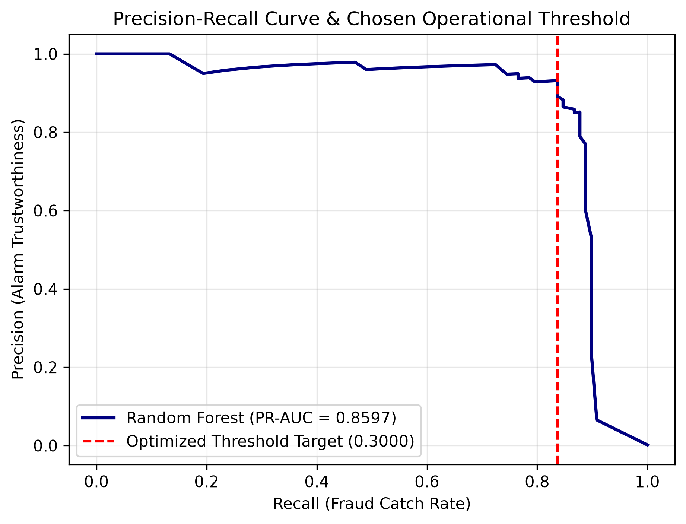

# Credit-Card-Fraud-Detection-Pipeline
An end-to-end Python pipeline using Random Forest to detect credit card fraud. Scaled using stratified anti-leakage splitting and optimized to a 0.3000 threshold to minimize financial loss and customer friction. An analysis of credit card fraud detection that optimizes for business costs rather than accuracy. It uses the public Kaggle credit card fraud dataset: 284,807 transactions, of which 492 (0.17%) are fraud.

## The Problem: The Accuracy Trap

Fraud is rare. A model that labels every transaction as legitimate scores 99.83% accuracy and catches zero fraud. Accuracy is therefore the wrong metric here. This project uses PR-AUC and recall-constrained precision instead.

## Method

1. **Stratified split (`split8020.py`):** 80/20 train/test split with `stratify=y`, so both sets keep the same fraud rate. `Amount` and `Time` are standardised with a `StandardScaler` fitted on the training set only, then applied to the test set. The V1–V28 features are already PCA-transformed and are not scaled.
2. **Models (`train.py`):** Logistic Regression and Random Forest (100 trees), both with class weighting to handle imbalance. Models are compared on PR-AUC on the test set.
3. **Threshold and evaluation (`evaluate.py`):** The Random Forest is retrained, and the threshold is chosen to reach at least 80% recall with the highest precision. The confusion matrix and classification report are printed for that threshold.
4. **Exploration (`demo.py`):** Prints the class balance of the raw dataset.

## Results

| Model | PR-AUC (test set) |
|---|---|
| Logistic Regression | 0.7159 |
| **Random Forest (100 trees, class-weighted)** | **0.8597** |

At the chosen threshold of **0.3000**, on 56,962 test transactions:

| | Predicted legitimate | Predicted fraud |
|---|---|---|
| **Actual legitimate** | 56,858 (true negatives) | 6 (false positives) |
| **Actual fraud** | 16 (false negatives) | 82 (true positives) |

- Precision: **93.2%** (82 of 88 alerts were real fraud)
- Recall: **83.7%** (82 of 98 fraud cases were caught)



## Threshold Choice and Its Limits

The threshold of 0.3000 was selected on the test set, so these recall and precision figures are optimistic. A cleaner approach is to choose the threshold on a separate validation split and report the final numbers on the untouched test set. That is the planned next step for this project.

The business trade-off is explicit: lowering the threshold catches more fraud but blocks more genuine customers. A bank would set this based on the cost of missed fraud versus the friction of false alarms.

## Limitations

- **Anonymised features:** V1–V28 are PCA components, so this project can't explain which merchant or customer factors drive fraud.
- **Batch analysis only:** This is an offline evaluation on a public dataset. A live system would need a low-latency scoring API, ongoing monitoring, and retraining as fraud patterns change.

## Project Structure

```
fraud-detection/
├── data/                  # Not committed. Holds creditcard.csv and generated splits
├── src/
│   ├── split8020.py       # Stratified split and scaling
│   ├── train.py           # Logistic Regression and Random Forest training
│   ├── evaluate.py        # Threshold selection and final evaluation
│   └── demo.py            # Class balance check
├── pr_curve.png
├── .gitignore             # Includes data/
└── README.md
```

## How to Run

1. Download `creditcard.csv` from the [Kaggle credit card fraud dataset](https://www.kaggle.com/datasets/mlg-ulb/creditcardfraud) and place it in `data/`.
2. Run the steps in order:

```bash
pip install pandas numpy scikit-learn matplotlib
python src/split8020.py
python src/train.py
python src/evaluate.py
```

Optional: `python src/demo.py` prints the class balance.
